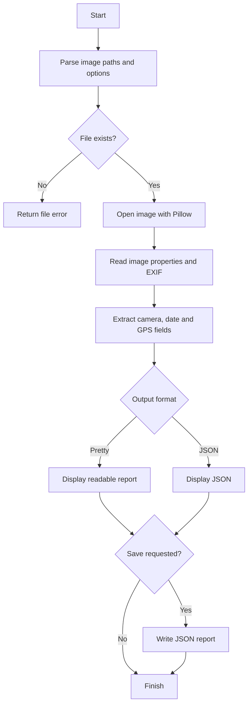
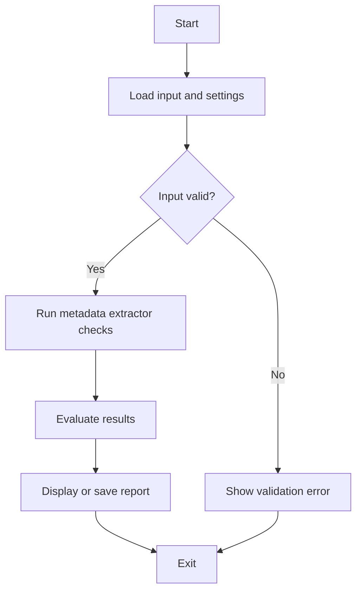

# 🧾 Metadata Extractor


## Get this repository

Clone the current project from its canonical GitHub location, then follow the installation and usage steps below.

```bash
git clone https://github.com/cyberworlduniversity/metadata_extractor.git
cd metadata_extractor
```

> **Tool #11 in the Kit** — Extract hidden metadata from image files including camera info, date/time, and GPS location data.

[](https://python.org)
[](https://github.com/hemanathan115)
[](LICENSE)

---

## 📌 What It Does

The **Metadata Extractor** reads hidden EXIF and metadata embedded inside image files and presents it in a clean, structured format. Think of it as X-ray vision for your photos!

### Extracted Data Includes:
| Category | Details |
|---|---|
| 📷 **Camera Info** | Make, Model, Lens, Focal Length, ISO, Aperture |
| 📅 **Date & Time** | Original capture date, digitized date |
| 📍 **GPS Location** | Latitude, Longitude, Google Maps link |
| 🖼️ **Image Properties** | Resolution, Format, Color Mode |
| 📁 **File Info** | Size, Path, Last Modified |

---

## 🚀 Installation

```bash
# Clone the repository
git clone https://github.com/cyberworlduniversity/metadata_extractor.git
cd metadata_extractor

# Install dependencies
python -m pip install -r requirements.txt
```

---

## ⚙️ Usage

### Basic Usage
```bash
python metadata_extractor.py photo.jpg
```

### JSON Output
```bash
python metadata_extractor.py photo.jpg --format json
```

### Save Report
```bash
python metadata_extractor.py photo.jpg --save report.json
```

### Batch Process Multiple Images
```bash
python metadata_extractor.py img1.jpg img2.jpg img3.png --batch
```

### Process All JPGs in a Folder
```bash
python metadata_extractor.py *.jpg --batch --save batch_report.json
```

---

## 📦 Dependencies

```
Pillow>=9.0.0,<13.0.0
```

Install with:
```bash
pip install -r requirements.txt
```

---

## 📸 Sample Output

```
============================================================
🧾  METADATA EXTRACTOR - RESULTS
============================================================

📁 File Information
----------------------------------------
  filename                  : photo.jpg
  file_size                 : 3.45 MB
  last_modified             : 2024-01-15 10:30:22

📷 Camera Information
----------------------------------------
  Make                      : Apple
  Model                     : iPhone 14 Pro
  FocalLength               : 6.86
  ISOSpeedRatings           : 50

📅 Date & Time
----------------------------------------
  DateTimeOriginal          : 2024:01:15 10:30:22

📍 GPS / Location
----------------------------------------
  DecimalLatitude           : 13.0827
  DecimalLongitude          : 80.2707
  GoogleMapsLink            : https://www.google.com/maps?q=13.0827,80.2707

============================================================
✅ Extraction Complete!
============================================================
```

---

## 🛡️ Supported Formats

- `.jpg` / `.jpeg`
- `.png`
- `.tiff` / `.tif`
- `.heic` (with Pillow-heif plugin)
- `.webp`

---

## 📁 Project Structure

```
metadata-extractor/
├── metadata_extractor.py   # Main script
├── requirements.txt        # Python dependencies
├── README.md               # Documentation
└── LICENSE                 # MIT License
```

---

## 🔒 Privacy Notice

This tool processes files locally and does not upload image contents. GPS metadata may reveal a photo's location; review reports before sharing them. Dependencies are installed only when you run the documented install command—this program never installs packages automatically.

---

## 👨‍💻 Author

**Hemanathan**  
GitHub: [@hemanathan115](https://github.com/hemanathan115)

---

## 📄 License

MIT License — feel free to use, modify, and distribute.


## 🧪 Run Tests

```bash
python -m unittest discover -v
```

## 🔄 Program Flow




## Repository Quick Start

Clone the canonical repository:

```bash
git clone https://github.com/cyberworlduniversity/metadata_extractor.git
cd metadata_extractor
```

### Requirements and installation

- Python 3.10+ is recommended.
Create an isolated environment and install dependencies:

```bash
python -m venv .venv
# Linux/macOS: source .venv/bin/activate
# Windows PowerShell: .venv\\Scripts\\Activate.ps1
python -m pip install -r requirements.txt
```

### Run

```bash
python metadata_extractor.py
```

For scripts that expose command-line options, use `python metadata_extractor.py --help` to inspect the options implemented in this version. Begin with sample or non-sensitive input.

### Validate source syntax

```bash
python -m compileall -q .
```

Image metadata can expose GPS coordinates and device details. Review and redact reports before sharing.

### Program flow


